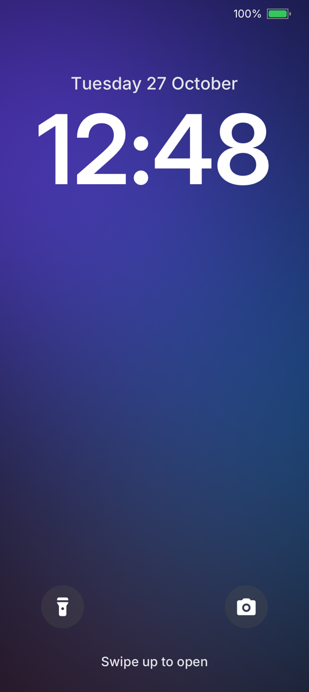
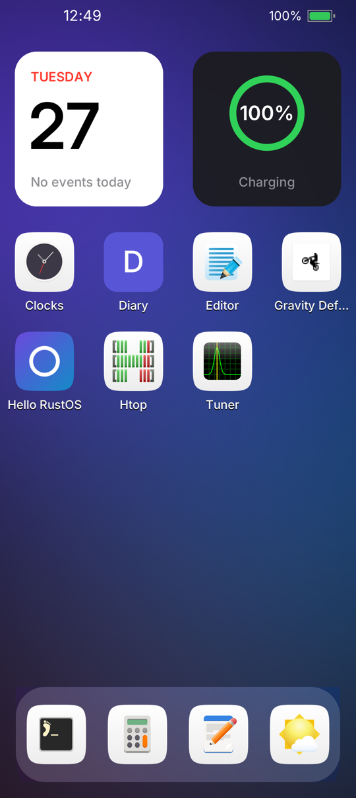
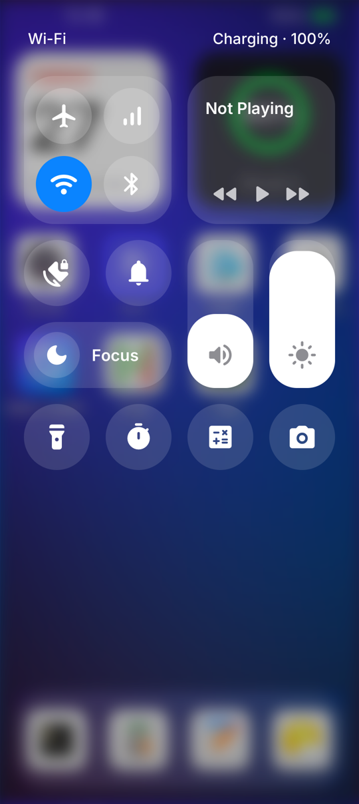
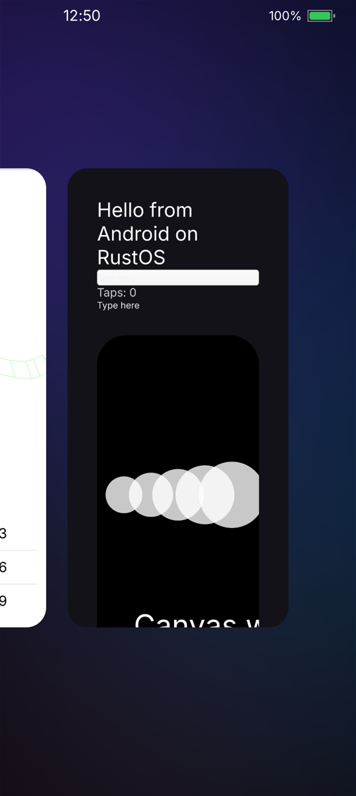
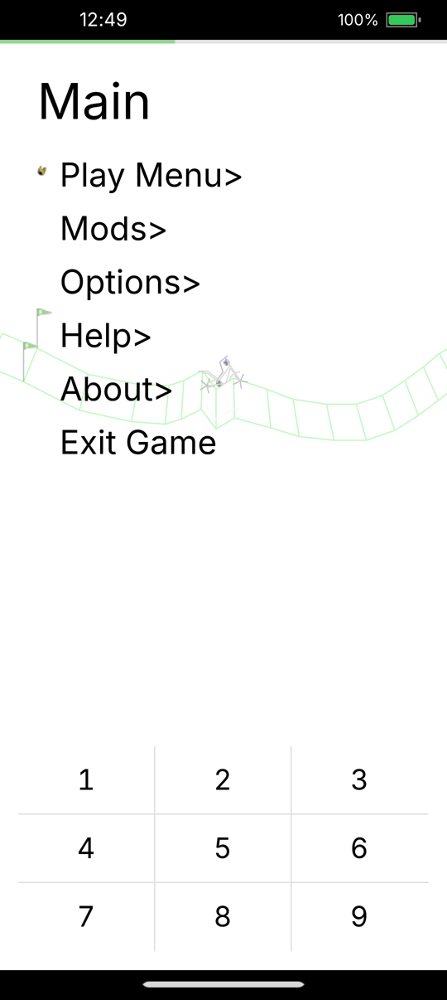

# Pengust

We are building **Rust OS**: a multiplatform operating system written in
Rust, for phones first and for tablets, laptops and watches after. It runs on
mainline Linux and boots straight into our own code: our own initramfs,
PID 1, service manager and Wayland compositor with a phone shell, and it runs
Android apps natively, without a container.

The first device is the **Nothing Phone (2)** (Snapdragon 8+ Gen 1). Every
screenshot below is from that phone, running Rust OS.

<table>
  <tr>
    <td></td>
    <td></td>
    <td></td>
    <td></td>
    <td></td>
  </tr>
  <tr>
    <td align="center">Lock screen</td>
    <td align="center">Home</td>
    <td align="center">Control Center</td>
    <td align="center">App switcher</td>
    <td align="center">Android app (F-Droid)</td>
  </tr>
</table>

## What is in it

**The shell** is a Wayland compositor built on [Smithay](https://github.com/Smithay/smithay),
drawn with OpenGL ES on the phone's Adreno GPU:

- Lock screen with a large clock; swipe up to unlock
- Home screen with widgets, a glass dock and app icons on uniform squircles
- Control Center over real-time blur: Wi-Fi, airplane mode, brightness,
  toggles and shortcuts
- Apps open and close with spring animations from their icons; swipe up to go
  home, pause halfway for the app switcher, flick a card away to close it
- On-screen keyboard, Wi-Fi networks and password entry
- Runs GTK and other Wayland apps, and Android apps

**Android apps run natively.** APKs run on ART directly on the host through
the [Android Translation Layer](https://gitlab.com/android_translation_layer/android_translation_layer),
with our fixes for apps that need more of the Android API. The shell routes
touch and keyboard text to them like any other app. The next step is running
Android's own framework natively over the kernel's Rust Binder, so every app
works.

**Under the shell, everything boots from our code:**

| Piece      | What it does |
|------------|--------------|
| `initrd`   | Stage 1: brings up USB networking, finds the root filesystem, starts init |
| `init`     | PID 1: mounts, reaps, starts the service manager |
| `svcd`     | Service manager with dependency ordering, per-service logs and a control socket |
| `powerd`   | Suspends the system whenever nothing keeps it awake |
| kernel     | Mainline Linux 7.2 with Rust and the Rust Binder driver |

**One base OS, many devices.** The base OS knows nothing about a particular
device. Each device has its own repository with a `device.toml` (kernel,
boot, display layout) and, where needed, its own services, files and boot
hooks. Bringing up a new device means writing one of those, not forking the
OS.

## Repositories

| Repository | |
|------------|---|
| [rustos](https://github.com/Pengust/rustos) | The base OS: initramfs, init, service manager, compositor and shell |
| [device_nothing_phone2](https://github.com/Pengust/device_nothing_phone2) | Nothing Phone (2): device description, services, boot image |
| [kernel_nothing_pong-rustos](https://github.com/Pengust/kernel_nothing_pong-rustos) | Mainline Linux for the Phone (2) with Rust and Rust Binder |
| [android_translation_layer](https://github.com/Pengust/android_translation_layer) | Android Translation Layer with our fixes |

The repositories are private while the system takes shape.

## Status

Rust OS is early. On the Phone (2) today: boot to the shell in a few seconds,
touch, the display at 120 Hz with GPU rendering, Wi-Fi, Bluetooth hardware, battery
and charging, sensors, the modem's remote processors, GTK and Android apps.
Next: calls and SMS, audio, notifications, our own native apps and the
native Android framework.

Upstream fixes from this work go to the Linux kernel mailing lists.
