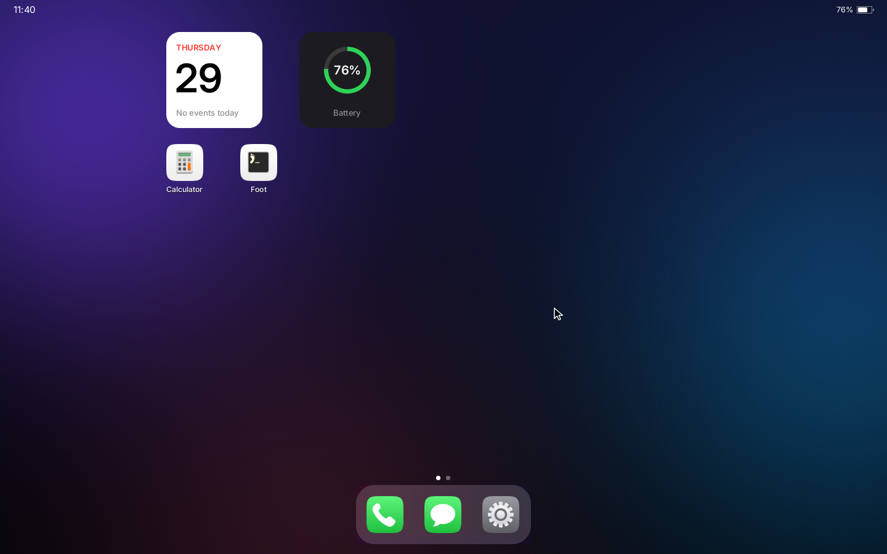
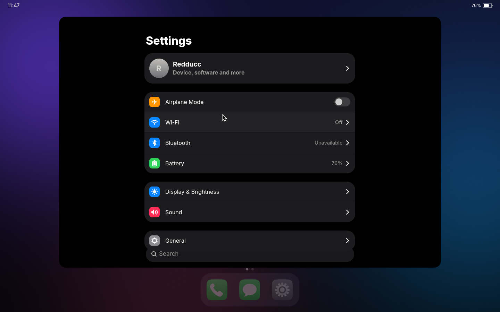
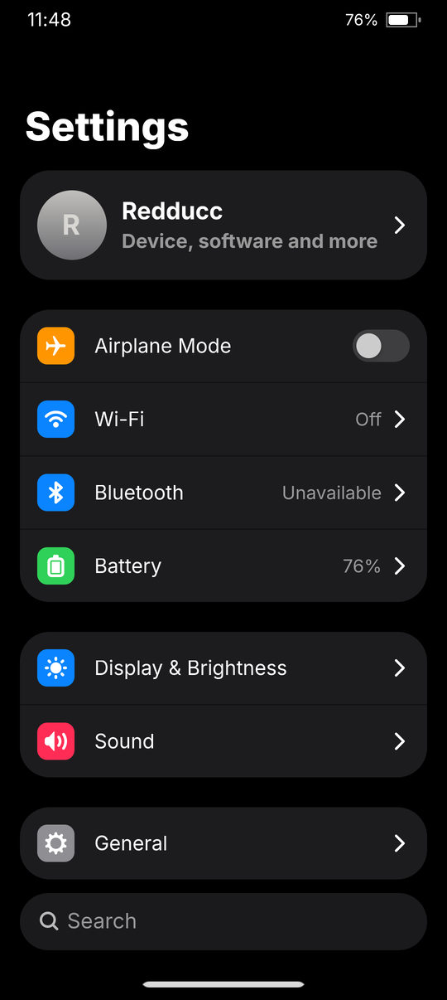

# Pengust

We are building **Rust OS**: an operating system for phones, tablets and PCs.
It runs on Linux and boots straight into our own code, written in Rust: our
own initramfs, PID 1, service manager, and a Wayland compositor whose shell
adapts to the screen it runs on. Android apps run on Android's own
userspace, built from AOSP, side by side with Rust OS's apps.

## On the phone

The first device is the **Nothing Phone (2)** (Snapdragon 8+ Gen 1). These
screenshots are from that phone, running Rust OS.

<table>
  <tr>
    <td></td>
    <td></td>
    <td></td>
    <td></td>
    <td></td>
  </tr>
  <tr>
    <td align="center">Lock screen</td>
    <td align="center">Home</td>
    <td align="center">Control Center</td>
    <td align="center">App switcher</td>
    <td align="center">Android app (F-Droid)</td>
  </tr>
</table>

## On a PC

The same shell and apps on a wider screen: home lays out for it, apps open
as windows, and a mouse and keyboard work as on any desktop. These
screenshots, and the new Settings, are the shell running in a window on
Windows (WSL), which is also how we work on the UI without a device.

<table>
  <tr>
    <td></td>
    <td></td>
    <td></td>
  </tr>
  <tr>
    <td align="center">Home on a PC</td>
    <td align="center">Settings, as a window</td>
    <td align="center">Settings on a phone</td>
  </tr>
</table>

## What is in it

**The shell** is a Wayland compositor built on [Smithay](https://github.com/Smithay/smithay),
drawn with OpenGL ES:

- Lock screen, home with widgets and a glass dock, Control Center over
  real-time blur, an app switcher, and apps that open from their icons with
  spring animations
- On a phone, full-screen apps and swipe gestures; on a tablet or PC, a
  centred home, a dock sized to its apps, and apps as windows
- Touch, an on-screen keyboard, a mouse and a keyboard
- GTK and other Wayland apps, and Android apps

**Our own apps**, in Rust with GTK 4 and libadwaita: Settings, Phone and
Messages.

**Android apps run natively.** Android's userspace (ART, the framework and
its services) is built from AOSP and runs directly on the host, without
Android's init or a container, over the kernel's Rust Binder. Each Android
app is a window of the shell's, like any other app.

**Under the shell, everything boots from our code:**

| Piece | What it does |
|---|---|
| `initrd` | Stage 1: brings up USB networking, finds the root filesystem, starts init |
| `init` | PID 1: mounts, reaps, starts the service manager |
| `svcd` | Service manager with dependency ordering, per-service logs and a control socket |
| `powerd` | Suspends the system whenever nothing keeps it awake |
| kernel | Mainline Linux with Rust and the Rust Binder driver |

**One root filesystem, built by our build.** It holds the userland (Alpine
packages), Rust OS, and Android's partitions and data, so both systems
share one filesystem.

**One base OS, many devices.** The base knows nothing about a particular
device. Each device has a repository with its description, services,
packages and boot hooks. Today there are two: the Phone (2) and PCs.

## Building

Rust OS is many repositories, checked out together by `repo` from one
manifest, and built like AOSP:

```sh
. rustos/envsetup.sh
lunch nothing_phone2-userdebug
m
```

| Repository | |
|---|---|
| `manifest` | The manifest: every repository, and the AOSP projects Rust OS's Android is built from |
| `rustos` | The base OS: initramfs, init, service manager, compositor and shell, build system |
| `android` | Android's userspace on Rust OS |
| `apps_settings`, `apps_phone`, `apps_messages`, `apps_modem`, `apps_notifyd` | Rust OS's apps |
| `device_nothing_phone2`, `device_generic_pc` | Devices |
| `kernel_nothing_pong-rustos` | Mainline Linux for the Phone (2) with Rust and Rust Binder |
| `android_translation_layer` | Android Translation Layer with our fixes |

The repositories are private while the system takes shape.

Upstream fixes from this work go to the Linux kernel mailing lists.
