# Pengust

We are building **Rust OS**: an operating system for phones, tablets and PCs.
It runs on Linux and boots straight into our own code, written in Rust: our
own initramfs, PID 1, service manager, and a Wayland compositor whose shell
adapts to the screen it runs on. Android apps run on Android's own
userspace, built from AOSP, side by side with Rust OS's apps.

## On the phone

The first device is the **Nothing Phone (2)** (Snapdragon 8+ Gen 1). These
screenshots are from that phone, running Rust OS.

<table>
  <tr>
    <td>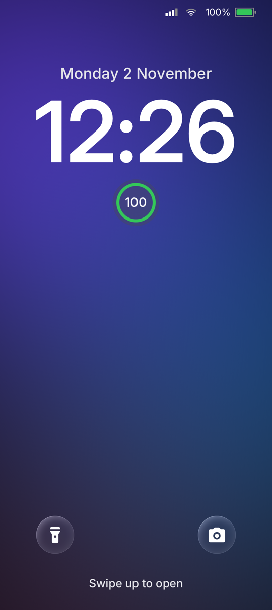</td>
    <td>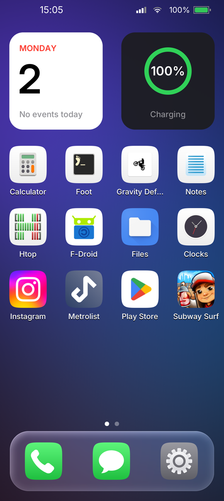</td>
    <td>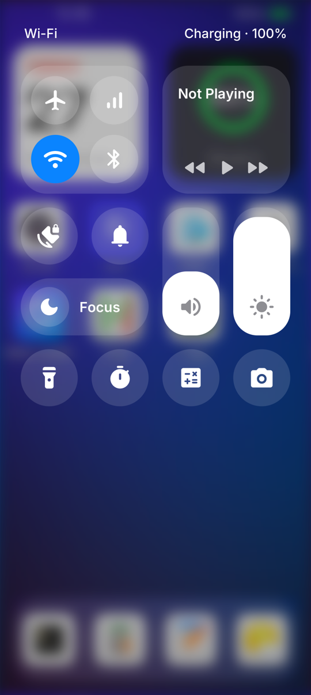</td>
    <td>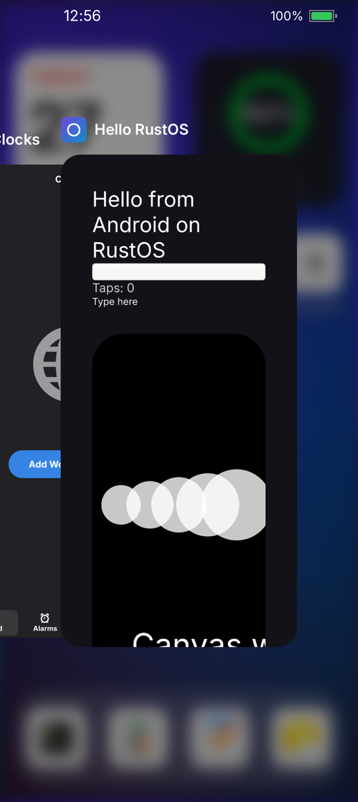</td>
    <td>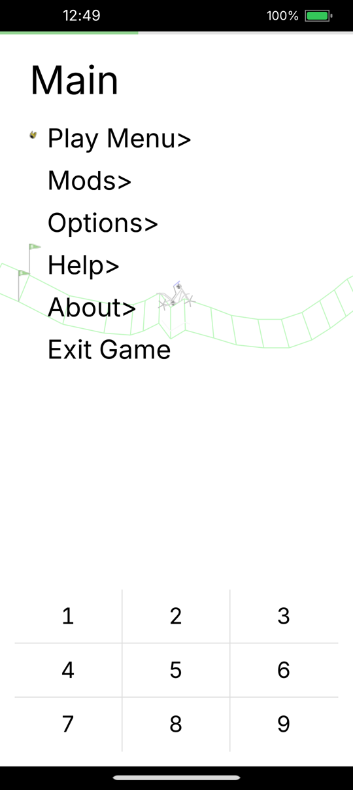</td>
  </tr>
  <tr>
    <td align="center">Lock screen</td>
    <td align="center">Home</td>
    <td align="center">Control Center</td>
    <td align="center">App switcher</td>
    <td align="center">Android app (F-Droid)</td>
  </tr>
</table>

## On a PC

The same shell and apps on a PC: a desktop with windows, a menu bar, a dock
of open apps, Spotlight, Mission Control, Spaces and a Notification Centre,
under Liquid Glass. The PC image boots Android's userspace too, and Steam
runs from Flathub. These screenshots are the PC image running in a virtual
machine.

<table>
  <tr>
    <td>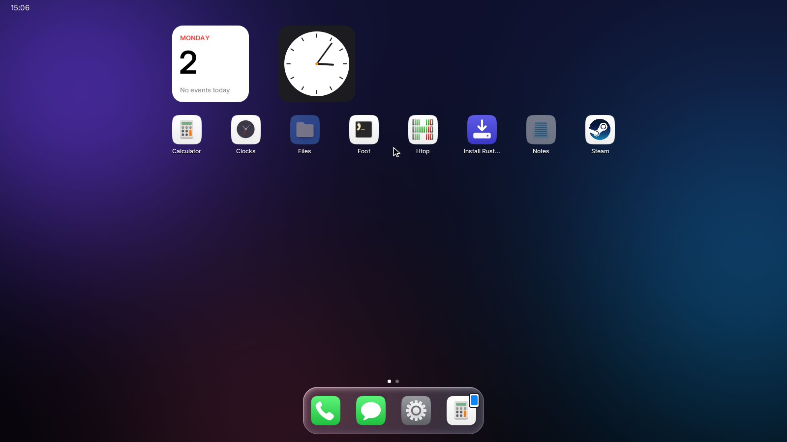</td>
    <td>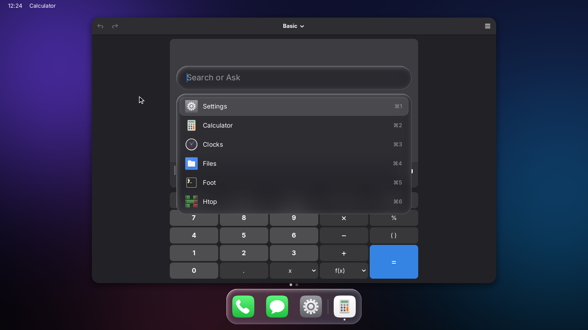</td>
  </tr>
  <tr>
    <td align="center">The desktop (Handoff from the phone at the dock's end)</td>
    <td align="center">Spotlight, in glass, over an app</td>
  </tr>
</table>

A tablet can have the desktop too, by touch: its device says so, or the
user picks it in Settings.

## Continuity

A phone and a PC on the same network act as one. They find each other, pair
once (both screens show the same code), and talk over TLS, each device known
by its own certificate. Every part can be turned off in Settings.

- **Clipboard**: copy on one, paste on the other
- **Notifications**: the phone's show on the PC, and can be answered there
- **Texts**: the phone's conversations in the PC's Messages, sent through the phone
- **Files**: sent either way, into Downloads
- **Handoff**: the app open on the phone waits at the end of the PC's dock
- **Personal Hotspot**: turned on and joined from the PC's Wi-Fi list
- **Universal Control**: past the edge of the PC's screen, its mouse and
  keyboard go on to the phone or tablet beside it, and come back the same
  way

<table>
  <tr>
    <td>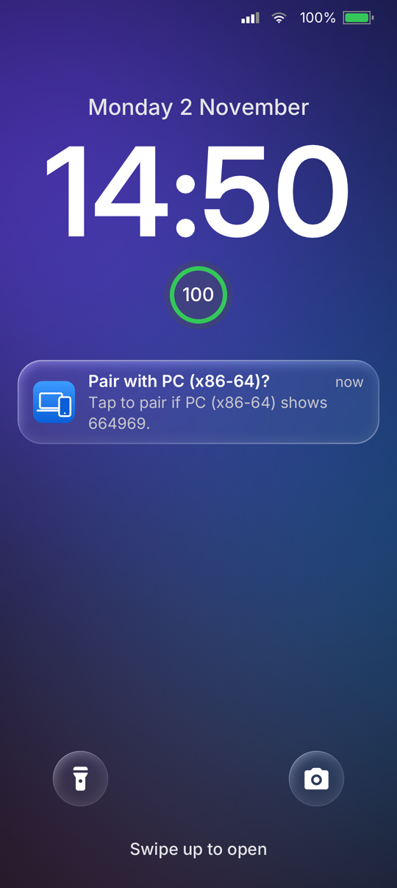</td>
    <td>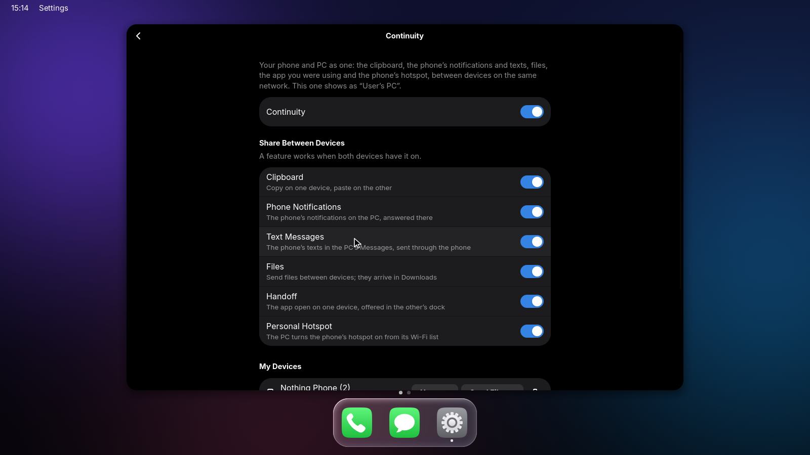</td>
    <td>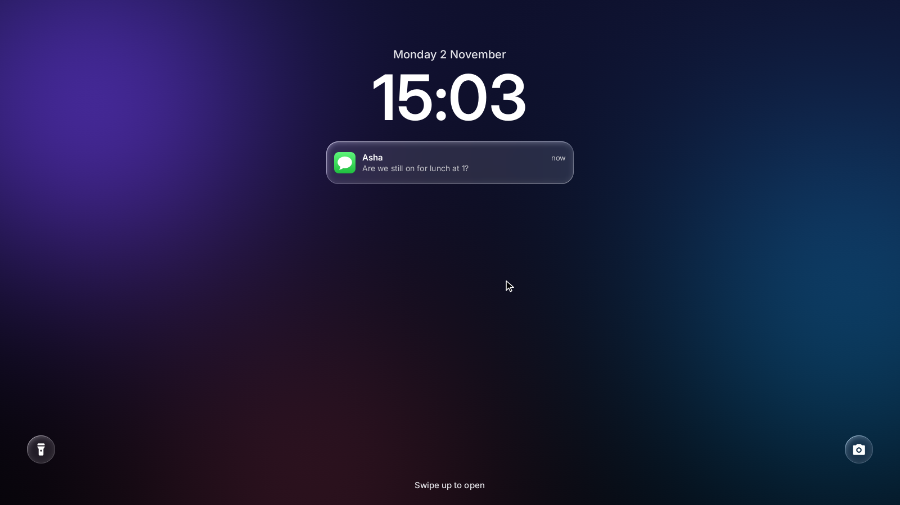</td>
    <td>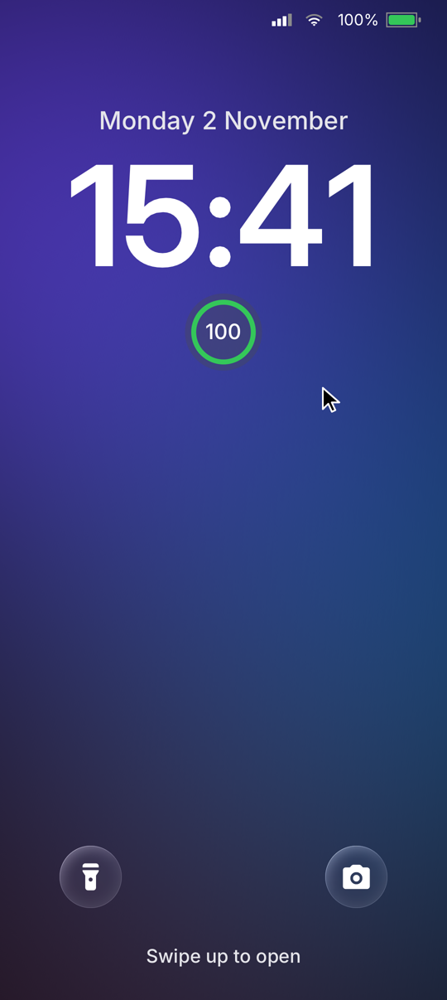</td>
  </tr>
  <tr>
    <td align="center">Pairing, on the phone</td>
    <td align="center">Continuity in Settings</td>
    <td align="center">A phone's message on the PC</td>
    <td align="center">The PC's pointer on the phone</td>
  </tr>
</table>

Next: the phone's screen and apps in a window on the PC (its games
included), and a partitioning installer for dual boot.

## What is in it

**The shell** is a Wayland compositor built on [Smithay](https://github.com/Smithay/smithay),
drawn with OpenGL ES:

- Lock screen with widgets and Live Activities, an always-on display, home
  with widgets, Control Center, an app switcher, and apps that open from
  their icons with spring animations, all in Liquid Glass
- On a phone, full-screen apps and swipe gestures; on a tablet or PC, a
  desktop: windows that snap and tile, a menu bar, a dock of open apps,
  Spotlight, Mission Control, Spaces, a Notification Centre, screenshots
  of a region, drag and drop between windows
- Touch, an on-screen keyboard with suggestions, autocorrect and emoji, a
  mouse and touchpad gestures, and a keyboard
- Focus, Night Shift, Screen Time, a screen reader
- GTK and other Wayland apps, Flatpak apps (Steam), X11 apps through
  Xwayland, and Android apps

**Our own apps and services**, in Rust with GTK 4 and libadwaita:
Settings, Phone and Messages, a notification server, and `linkd`, which
links a user's devices (Continuity).

**Android apps run natively.** Android's userspace (ART, the framework and
its services) is built from AOSP and runs directly on the host, without
Android's init or a container, over the kernel's Rust Binder. Each Android
app is a window of the shell's, like any other app.

**Under the shell, everything boots from our code:**

| Piece | What it does |
|---|---|
| `initrd` | Stage 1: brings up USB networking, finds the root filesystem, starts init |
| `init` | PID 1: mounts, reaps, starts the service manager |
| `svcd` | Service manager with dependency ordering, per-service logs and a control socket |
| `powerd` | Suspends the system whenever nothing keeps it awake |
| kernel | Mainline Linux with Rust and the Rust Binder driver |

## One filesystem

One ext4 filesystem holds the whole system: Rust OS, the userland under it
(Alpine packages), Android's partitions and both systems' data. On a phone
it is the `userdata` partition; on a PC, a partition of its own. Our build
makes it as one image.

| Path | What |
|---|---|
| `/usr`, `/etc`, `/lib` | the userland; Rust OS's programs in `/usr/lib/rustos`, its apps in `/usr/bin` |
| `/usr/lib/rustos/services` | the service manager's units |
| `/usr/lib/rustos/device.toml` | the device's description |
| `/system`, `/system_ext`, `/product`, `/vendor`, `/odm` | Android's partitions, as directory trees |
| `/apex` | Android's APEXes, mounted at boot by its own `apexd` |
| `/data` | Android's data |
| `/home/<user>` | the user's own files |

Android's paths are ones a Linux system never uses, so the two share one
filesystem without stepping on each other: Rust OS sees Android's files
(its shell shows Android's apps as its own), and Android runs on the same
kernel and devices.

## Android, natively

Android's userspace (ART, the framework, its services and HALs) is built
from AOSP source, only what we need of it, and runs directly on Rust OS:
no container, no virtual machine and no Android init. What Android's init
would do, Rust OS does:

| Android's | Rust OS's |
|---|---|
| init and its `.rc` files | `svcd` units start servicemanager, apexd, logd, netd, zygote and the HALs |
| system properties | `propd`, in Rust: the property area bionic reads and the property service |
| Binder | the kernel's Rust Binder driver, on binderfs |
| wake locks and suspend | Android's suspend service on `powerd`: its wake locks hold the system up |
| SurfaceFlinger's display | `android-display`: each Android app is a Wayland window of the shell's |
| notifications | Android's, in the shell's notification server, with the app's icon |

The framework and apps run in Android's own network and cgroup namespaces:
Android manages its firewall and routing as it expects to, behind Rust OS's
own connection, Wi-Fi and modem. Android apps install from APKs or a store,
show in the App Library, and take touch, the mouse and the keyboard.

**Google Mobile Services are integrated:** Play services and the Play Store run on the phone.

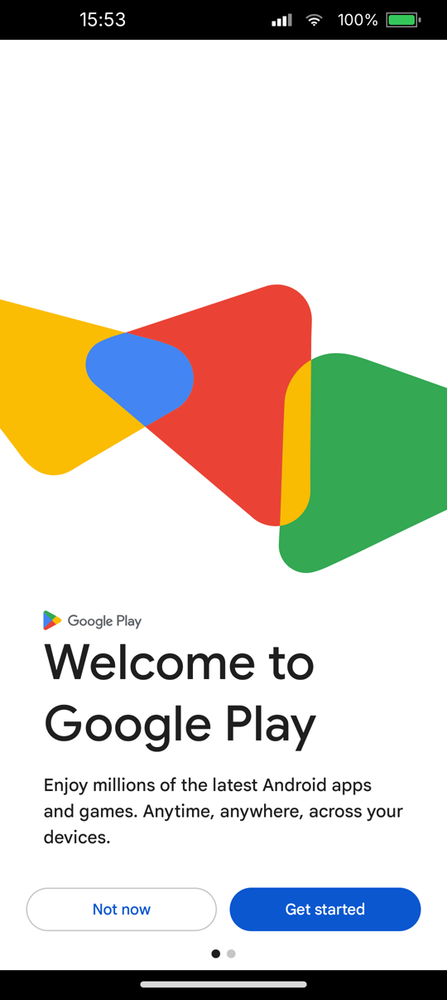

## Devices

**One base OS, many devices.** The base knows nothing about a particular
device. Each device has a repository with its description, services,
packages and boot hooks. Today there are two: the Phone (2) and PCs.

## Building

Rust OS is many repositories, checked out together by `repo` from one
manifest, and built like AOSP:

```sh
. rustos/envsetup.sh
lunch nothing_phone2-userdebug
m
```

| Repository | |
|---|---|
| `manifest` | The manifest: every repository, and the AOSP projects Rust OS's Android is built from |
| `rustos` | The base OS: initramfs, init, service manager, compositor and shell, build system |
| `android` | Android's userspace on Rust OS |
| `apps_settings`, `apps_phone`, `apps_messages`, `apps_modem`, `apps_notifyd` | Rust OS's apps |
| `device_nothing_phone2`, `device_generic_pc` | Devices |
| `kernel_nothing_pong-rustos` | Mainline Linux for the Phone (2) with Rust and Rust Binder |

The repositories are private while the system takes shape.

Upstream fixes from this work go to the Linux kernel mailing lists.
